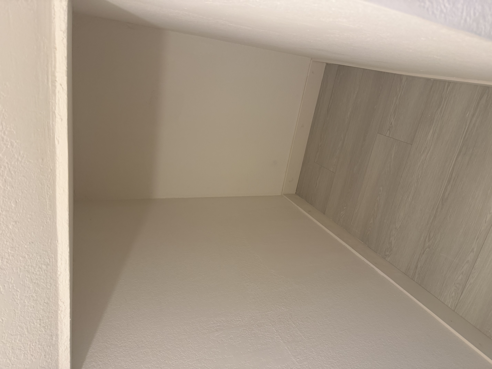
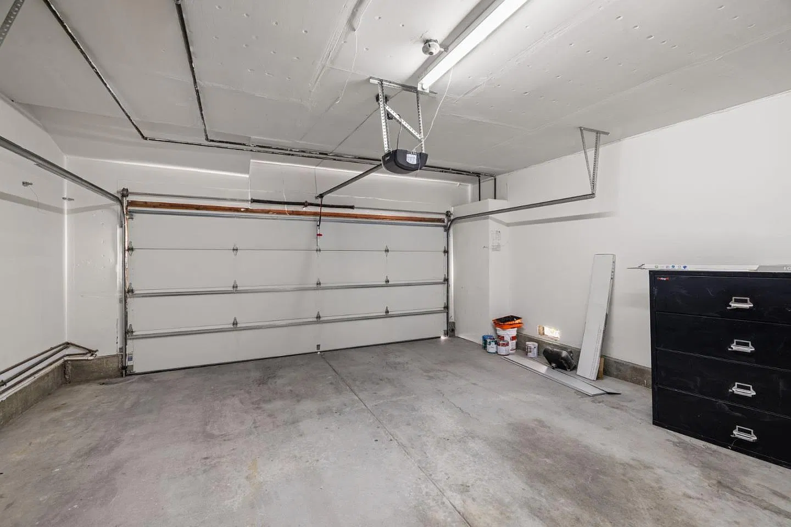
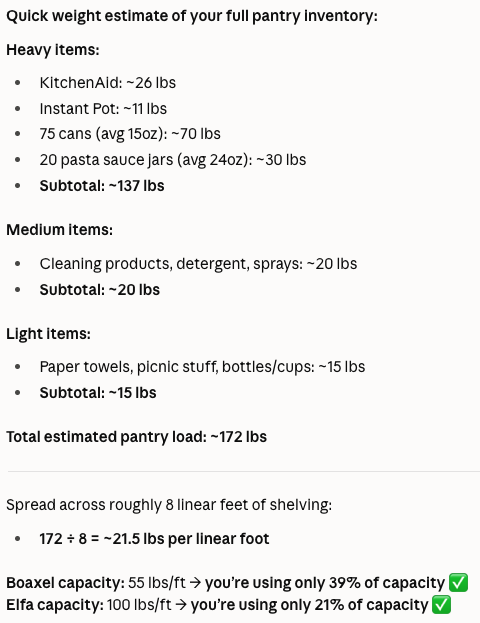
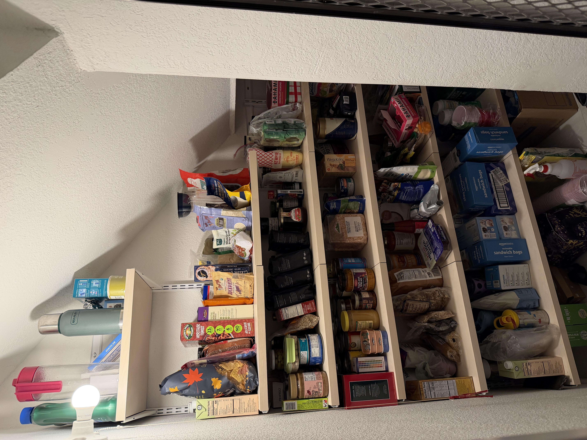
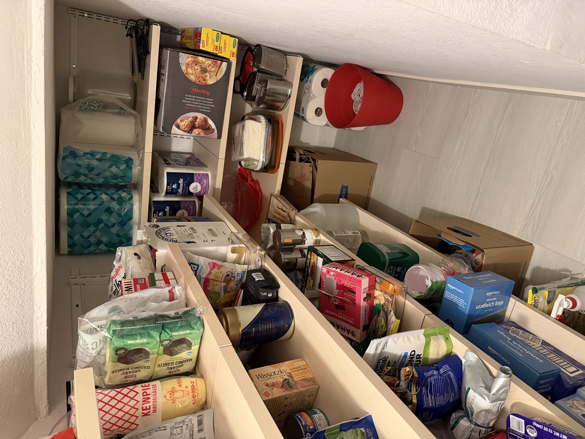
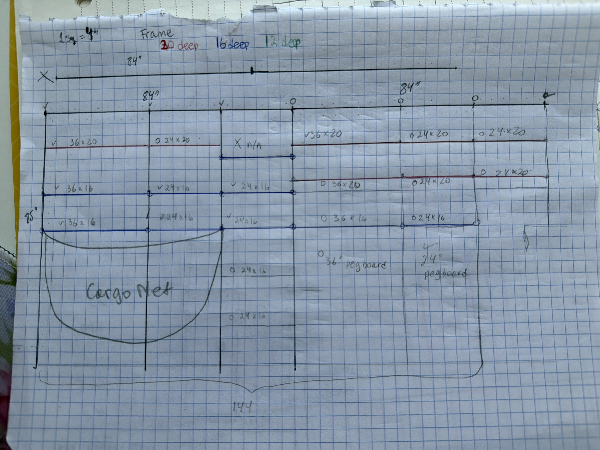
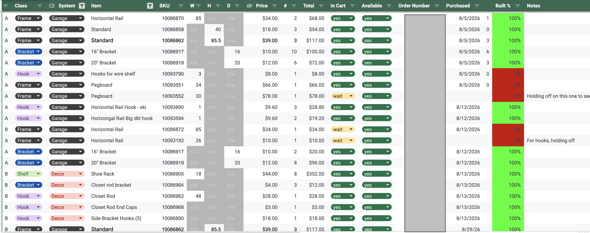
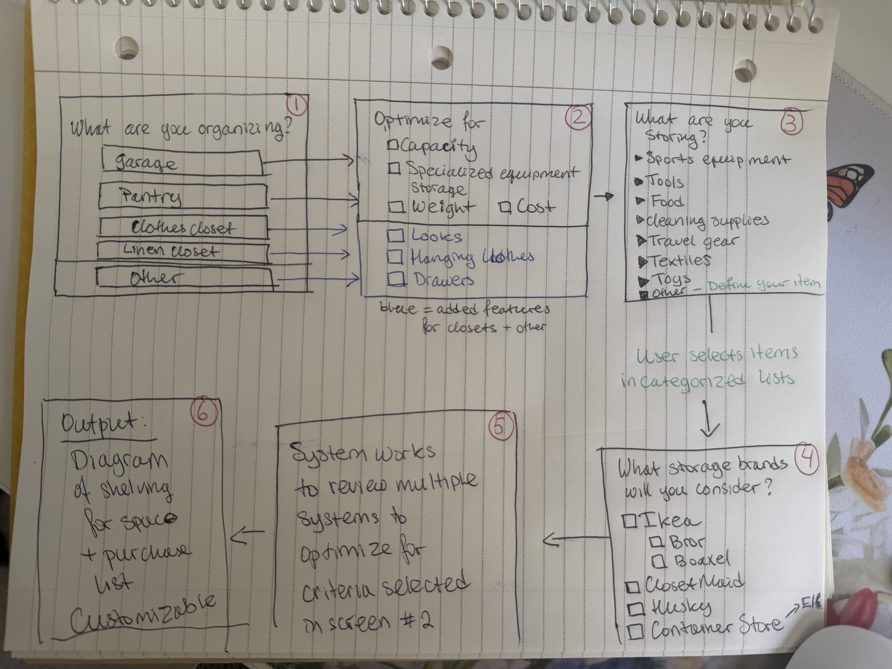

# Welcome to BuddyBuilder!

After spending hours on optimizing my own space setup, I decided to replicate my process through an app.

## How it started
I was excited to move to my new house and start organizing it just the way I wanted.

For some, no shelving in garage, pantry, or linnen closet may have been a downside. For me, it meant a food for creativity and adult legos.

The pantry and my garage were my priority.

### The Pantry
The pantry is pretty funky, it's basically a Harry Potter closet: half of it has slanted ceiling, coming into a half-height area. I did not get the full before picture.

### The Garage

> The seller left this metal fling cabinet.  It took 6 movers to get it in the corner of the garage.

## The Pantry!

I had lots of ideas!  

My first thought was to **custom-build long drawers** for that half-height area so that nobody would have to walk in there, but it mant that the rest of the space had to remain completely open for the drawers to go somewhere when opened - idea scrapped.

**Cheap and easy prototype: rolling carts.** But the ones I got, had wheels that had to turn when changing direction - they would bump into the walls in the narrow space - no good.

Finally, my daughter suggested I go with something a bit more plain and ***just do shelves***.  On one hand... booooriiiing!  On the other hand... probably the most sensible thing.

So... **shelves it is** - out of the mouths of babes :shrug:

### But what shelves?
#### Requirements First
1. **Storage Needs**
    - House cleaning supplies
    - Paper products
    - Canned food / jars
    - Grains and pasta
    - and so on...
2. **Weight Capacity**: I talked to Claude to estimate max storage needs.  I presumed that a 12 or 18 deep shelf full of cans would be the heaviest carring about 
    - 
3. **Measurements**: the fun part!
Because of its slanted ceiling, and a fairly narrow back part, I really wanted to optimize the space at the very top and on the back wall.
    - 
    - 
4. Other:
    - **Configurable!**: I wanted to change my mind, rearrange my shelves, and have some flexibility in how I would use this closet in the future
    - **Mounting**: off-the-floor
        - because of limited space (especially in the back), I did not want shelving to sit on the floor
        - It also has crawl space access, and I did not want to restrict my shelf depth by the floor space I had between the wall and the crawl space
    - **Intstallation difficulty**: Medium
        - I can measure, level, and drill, but I can't saw (I mean... I can, I just really don't want to)

#### Solution Process
With my mounting requirements, I was able to rule out Ikea Bror and similar shelving units.  I landed on Ikea's Boaxel and Elfa from Container Store.

Between the two, Elfa had the greater weight capacity (I went with Boaxel in my linen closet and did not have the confience it would hold 5 jars, let alone 20 that Claude suggested)

But... I had fun optimizing the space.  It became a math / geometry problem.  

- Elfa 
    - Shelves width: 18", 24", and 36"
    - Height of vertical standards: 40", 60", and 85"
- Ikea Boaxel: 
    - Shelves width: 7 7/8", 15.75 - that narrow shelf is adjustible, but its weight capacity suffers when it's widened.
    - Height of vertical standards: 39 5/8", 78.5" 

I won't bore you with my calculation details - you will see the process as I drew it out for the garage. 

BUT, what I will say is that it took a few iterations AND I disagreed with Container Store employees AND won ;)
> 🛠️ TODO: I will eventually rehash this story in a separate page.  Bottom line - my back wall is beautifully optimized - see pictures below

### Installation
> 🛠️ TODO: I will eventually summarize my fun here ;) I got a new set of drill bits out of it and drilled holes in my wall WAY bigger than I was initially comfortable with.  It was a great experience, and a great practice project for the garage!

### End Result
I spy with my little eye lots of buckwheat, eggplant caviar, and canned fish - hmmm, could I BE any more Russian?!? 
#### Wall A

#### Wall B

## Garage
🛠️ Writeup coming soon

In the meantime, here's a preview in images

## Idiating on BuilderBuddy
I submitted this to Claude Design.  It came up with a neat prototype, but I decided to build the real thing with Claude Code.

> 🛠️ Coming soon

